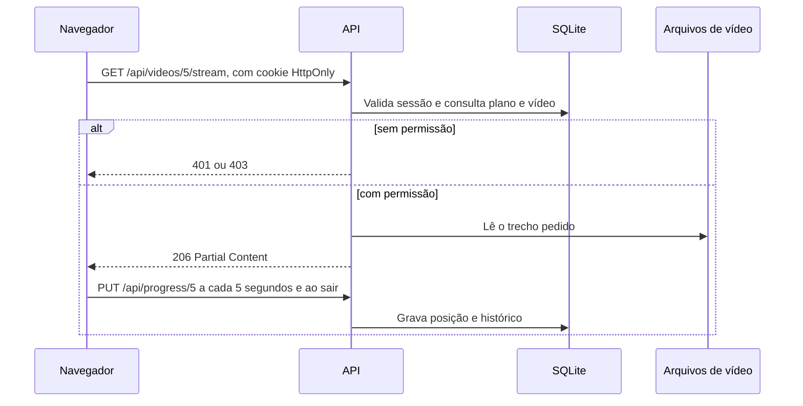

# Arquitetura

## Stack

| Camada | Escolha | Motivo |
|---|---|---|
| Servidor | Python, Starlette, Uvicorn | Simples, assíncrono e com suporte a `Range` para vídeo |
| Validação | Pydantic | Rejeita campos desconhecidos e dados inválidos |
| Banco | SQLite com `sqlite3` | Persistente, sem infraestrutura adicional |
| Frontend | React compilado com esbuild | Um único processo serve a API e a interface |
| Senhas | scrypt, da biblioteca padrão | Hash seguro sem dependência nativa |

A equipe havia escolhido FastAPI. Como o pacote não estava disponível no ambiente de construção, usamos Starlette, que é a base do FastAPI, para entregar código realmente testado. A troca é mecânica: as rotas e as regras ficam em funções simples, e o FastAPI aceita os mesmos modelos Pydantic.

## Fluxo de uma reprodução

## Modelo de dados

- `users`: identidade, hash da senha, papel (`admin` ou `subscriber`), plano (`trial` ou `premium`), fim do teste, data de ativação da oferta, empresa e cargo.
- `profiles`: de 1 a 3 por conta, com nome único dentro da conta.
- `sessions`: hash do token, usuário, perfil ativo e expiração.
- `categories`: nome, identificador e ordem.
- `videos`: metadados, categoria, nível de acesso, situação, arquivo, miniatura e licença.
- `progress`: uma linha por perfil e vídeo, com posição, conclusão e datas. É a base do histórico e de "continuar assistindo".
- `saved_paths`: respostas e resultado do diagnóstico de cada perfil.

Bancos criados antes dos perfis são migrados no início do servidor, em uma única transação: cada conta ganha um perfil, que herda o progresso, as trilhas e as sessões abertas.

## Autenticação e autorização

- O login cria um token aleatório. Só o hash dele fica no banco, e o navegador recebe um cookie `HttpOnly` com `SameSite=Lax`.
- O logout apaga a sessão no servidor, então o cookie antigo deixa de valer.
- `security.video_access` é a regra única de acesso. O catálogo, o detalhe, o stream e o progresso usam a mesma função.
- Os arquivos de vídeo não têm rota pública. A única saída é o endpoint de stream, depois da validação.
- Rotas administrativas chamam `require_admin` antes de qualquer operação.
- O perfil ativo fica na sessão, no servidor. Rotas com dados de perfil chamam `require_profile`, que recusa a sessão sem escolha em vez de presumir um perfil. `owned_profile` responde 403 para perfil de outra conta.
- O plano fica na conta, então `video_access` não muda com o perfil.
- A oferta é calculada em `security.offer_state` a partir de `trial_ends_at`. Não há registro de início, então recarregar a página não reinicia o prazo. Preços e prazo vêm do servidor.
- O login tem limite de tentativas, a resposta usa cabeçalhos de segurança e a CSP bloqueia scripts externos.

## Diagnóstico

`backend/app/diagnostic.py` é uma árvore declarativa, sem IA generativa. Cada alternativa define a próxima pergunta e os sinais que ela gera. Cada regra liga um sinal a um vídeo, um peso e uma justificativa. O servidor valida o caminho e recalcula o resultado ao salvar, sem confiar no navegador.

## Falhas tratadas

- Dados inválidos retornam erro por campo.
- Falhas de rede e de reprodução mostram mensagem e, quando faz sentido, opção de tentar novamente.
- Falha ao salvar progresso avisa o usuário no player.
- Upload é gravado em arquivo temporário e validado antes de substituir o vídeo.
- Um vídeo sem arquivo não pode ser publicado.

## Gargalos e caminho para produção

| Gargalo do MVP | Evolução |
|---|---|
| SQLite aceita uma escrita por vez | PostgreSQL |
| Limite de login em memória, por processo | Redis |
| Vídeo servido pela aplicação | Armazenamento de objetos com CDN e URLs assinadas |
| Arquivo único por vídeo | HLS com múltiplas qualidades |
| Ativação simulada da oferta e ativação manual pelo administrador | Gateway de pagamento |
| Instância única | Contêineres atrás de um balanceador, com HTTPS |
